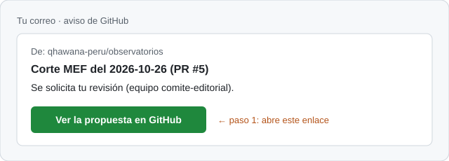
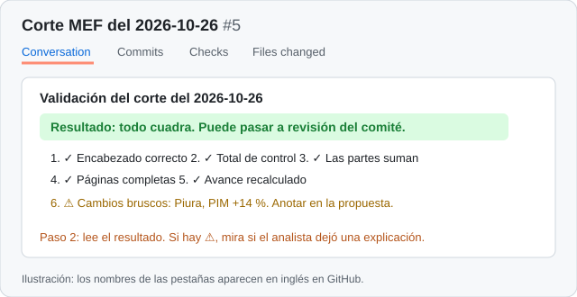
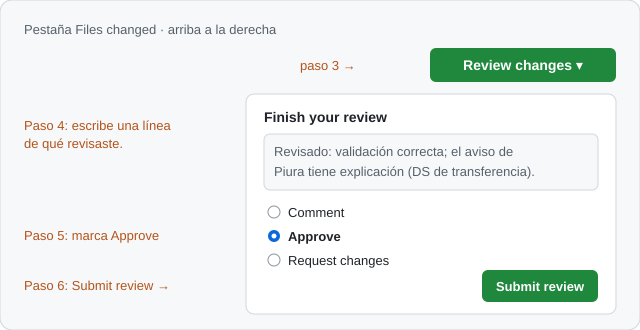

# Cartilla del comité: cómo aprobar en 5 minutos

Para miembros del comité editorial que no usan GitHub a diario. Solo vas a hacer tres cosas: **leer, comentar y aprobar.** La primera vez la haces acompañado por alguien del equipo de datos.

Antes de empezar necesitas tu cuenta de GitHub con verificación en dos pasos y la invitación a la organización Qhawana aceptada.

## 1. Te llega un correo

Cuando hay algo que revisar, GitHub te escribe. Abre el enlace del correo.

## 2. Lee el resultado de la validación

En la página de la propuesta, la pestaña **Conversation** muestra el informe automático.

- **"Todo cuadra"** en verde: los seis controles pasaron.
- **⚠ Cambios bruscos:** no es un error. Revisa si el analista dejó una explicación en un comentario. Si no la hay, pídela antes de aprobar.
- **Si es un hecho** (un decreto, un comunicado), abre el enlace de la fuente y comprueba que el texto diga lo que dice el documento.

## 3. Aprueba (o pide cambios)

1. Entra a la pestaña **Files changed**.
2. Arriba a la derecha, pulsa **Review changes**.
3. Escribe una línea sobre qué revisaste. Queda en el historial con tu nombre.
4. Marca **Approve** si está bien, o **Request changes** si falta algo, y explica qué.
5. Pulsa **Submit review**.

Después de tu aprobación, quien preparó la propuesta (o tú) pulsa **Merge pull request** y el sitio se actualiza solo.

## Tres reglas

- **No apruebas lo que preparaste.** GitHub tampoco te deja.
- **Apruebas solo desde tu propia cuenta.** Nadie aprueba "en tu nombre": el historial tiene que decir la verdad.
- **Si tienes un conflicto de interés** con el territorio o la entidad, no revisas esa propuesta. Escríbelo en un comentario para que otra persona la tome.

## Si te trabas

Escribe al gestor(a) de datos del equipo, con una captura de pantalla. Las ilustraciones de esta cartilla son aproximadas: GitHub muestra los botones en inglés y su diseño puede cambiar un poco.
